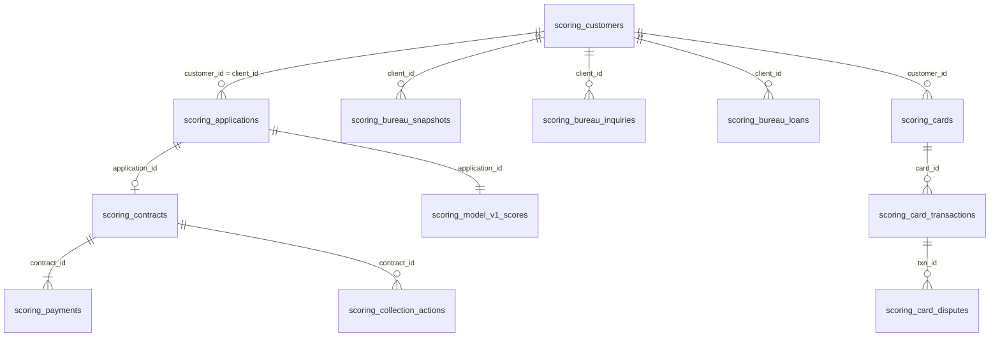
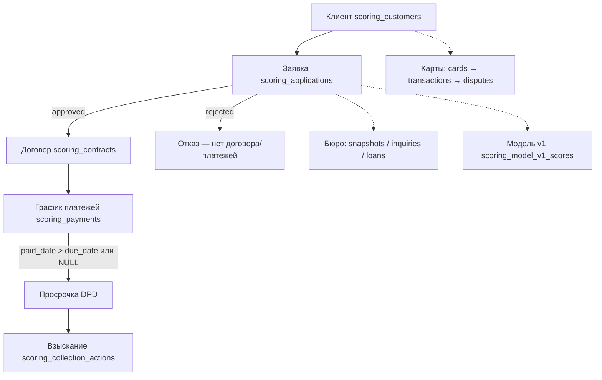
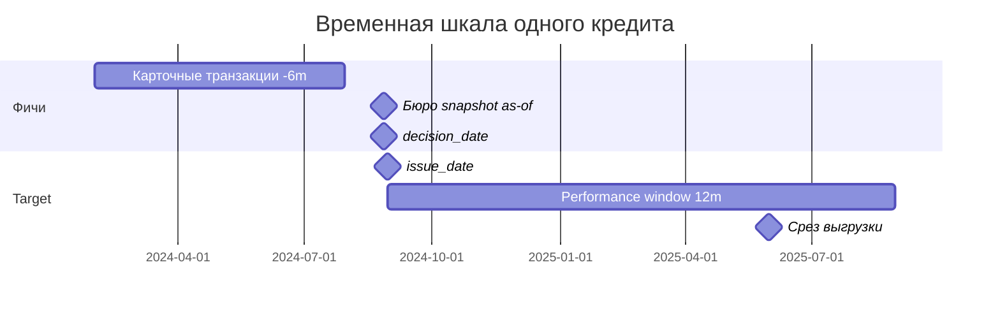

# Credit Scoring — Итоговый отчёт исследования базы `academy_db`

**Роль:** Senior Credit Risk Data Scientist  
**Срез данных:** 2025-05-31  
**Источник:** PostgreSQL `academy_db`, таблицы `scoring_*`  
**Принцип:** все выводы подтверждены SQL-запросами (см. `sql/`, `scripts/run_analysis.py`, `data/`)

---

## Этап 1. Полная карта базы

### 1.1. Инвентаризация таблиц

| Таблица | Строк | Размер | Назначение |
|---------|------:|--------|------------|
| `scoring_applications` | 18 000 | 2.4 MB | **Ядро:** заявки на кредит, анкета, решение |
| `scoring_contracts` | 11 277 | 1.3 MB | **Ядро:** выданные договоры (только approved) |
| `scoring_payments` | 103 150 | 10 MB | **Ядро:** график платежей, факт оплаты, основа target |
| `scoring_customers` | 8 000 | 944 KB | **Ядро:** демография клиентов банка |
| `scoring_bureau_snapshots` | 86 161 | 5 MB | **Ядро:** исторические снимки бюро (score, долг) |
| `scoring_bureau_inquiries` | 31 383 | 2.9 MB | **Ядро:** запросы в КБ |
| `scoring_bureau_loans` | 34 684 | 4.5 MB | **Ядро:** кредиты в бюро (с осторожностью — leakage в статусах) |
| `scoring_cards` | 12 614 | 1.3 MB | **Ядро:** карты клиентов |
| `scoring_card_transactions` | 1 044 743 | 138 MB | **Ядро:** транзакции по картам |
| `scoring_card_disputes` | 2 467 | 336 KB | **Ядро:** диспуты по транзакциям |
| `scoring_collection_actions` | 9 135 | 592 KB | Post-decision: взыскание |
| `scoring_model_v1_scores` | 18 000 | 960 KB | Post-decision / служебная: скор v1 |
| `scoring_applications_full` | 11 277 | 1.2 MB | **Мусор/leakage:** денормализованная витрина |
| `scoring_payments_backup` | 73 421 | 5.8 MB | **Мусор:** устаревший бэкап платежей |
| `scoring_clients_old` | 6 000 | 552 KB | **Мусор:** устаревший справочник клиентов |
| `scoring_txn_sample` | 5 000 | 560 KB | **Мусор:** сэмпл транзакций |
| `scoring_temp` | 0 | 8 KB | **Мусор:** пустая временная таблица |

**PK/FK в БД не объявлены** — связи восстановлены логически через SQL.

### 1.2. Логическая ER-карта

### 1.3. Ключи (логические)

| Таблица | Кандидат в PK | Уникальность | Комментарий |
|---------|---------------|-------------|-------------|
| `scoring_applications` | `application_id` | 18 000 / 18 000 ✓ | `client_id` не уникален (6 672 повтора — несколько заявок) |
| `scoring_contracts` | `contract_id` | уникален | 1:1 с approved заявками |
| `scoring_payments` | `payment_id` | уникален | ~9.2 платежа на договор в среднем |
| `scoring_bureau_snapshots` | `(client_id, snapshot_date)` | множественные снимки на клиента |
| `scoring_card_transactions` | `txn_id` | уникален | 1M+ строк |

### 1.4. Качество данных (ключевые находки)

- **NULL:** `employment_months` — 1 402 пропуска (7.8%); остальные поля анкеты без NULL
- **Дубликаты application_id:** 0
- **Связь approved → contract:** 11 277 = 11 277, разрывов нет
- **client_id ↔ customer_id:** только 5 891 из 11 328 уникальных клиентов заявок есть в `scoring_customers` — **существенный пробел покрытия**
- **Карточные транзакции:** 4 164 клиента с транзакциями из 11 328 (37%) — остальные без карточного поведения в БД

---

## Этап 2. Исследование каждой таблицы

### `scoring_applications`
- **Период:** 2023-06-01 — 2025-04-30
- **Решения:** approved 11 277 (62.65%), rejected 6 723 (37.35%)
- **Каналы:** mobile_app, branch, agent (равномерно ~6 000 каждый)
- **Вывод:** единственный источник анкеты и решения; `approved_by_old_policy` показывает смену политики (612 rejected были бы одобрены старой политикой; 362 approved — только новой)

### `scoring_contracts`
- **Период выдачи:** 2023-06-01 — 2025-05-01
- **Медианная сумма:** данные в `data/analysis_results.json`
- **Вывод:** полное соответствие approved-заявкам; `issue_date` ≥ `decision_date` (типичный лаг 1–5 дней)

### `scoring_payments`
- **103 150 платежей**, 11 277 договоров
- **DPD на уровне инсталмента (as-of 2025-05-31):** dpd=0: 40 740; 1–29: 50 429; 30–59: 1 722; 60–89: 1 324; **90+:** 8 935
- **Непогашенные (due ≤ срез, paid_date IS NULL):** значимая доля
- **Вывод:** основа для построения target; `scoring_payments_backup` — неполный бэкап (73 421 vs 103 150)

### `scoring_bureau_snapshots`
- **86 161 снимков**, ~10.8 на клиента в среднем
- **Период:** 2023-03-20 — 2025-05-28
- **Пропусков нет**
- **Вывод:** использовать только as-of join `snapshot_date ≤ decision_date`

### `scoring_bureau_loans`
- **34 684 записи**, `close_date` NULL у 21 300 (активные)
- **Leakage:** `current_dpd_bucket`, `status`, `outstanding_uzs` — состояние **на дату выгрузки**, не на decision_date
- **Безопасно:** `open_date`, `loan_amount_uzs` при фильтре `open_date ≤ decision_date`

### `scoring_card_transactions`
- **1 044 743 транзакций**, типы: purchase, salary_in, atm_cash, transfer и др.
- **decline_reason:** NULL у 997 517 (только у declined)
- **Период:** 2023-01-01 — 2025-05-31
- **Вывод:** богатый источник поведенческих фичей с временным окном до decision_date

### `scoring_collection_actions`
- **9 135 действий** по подмножеству договоров
- **Период:** post-issue, post-delinquency
- **Вывод:** только leakage / пост-фактум анализ, не для фичей

### `scoring_model_v1_scores`
- Скор и рекомендация на **все 18 000** заявок (включая rejected)
- **Вывод:** leakage при обучении новой модели «с нуля»; полезно для сравнения с текущей политикой

---

## Этап 3. Жизненный цикл кредита

**Путь в данных:**
1. Клиент идентифицируется `client_id` (= `customer_id` для ~52% заявок)
2. Заявка: анкета + `decision_date` + `final_decision`
3. При одобрении → договор с `issue_date` (медиана +3 дня от decision)
4. Ежемесячные платежи с `due_date`, факт `paid_date`
5. Просрочка = `paid_date - due_date > 0` или неоплата на срез
6. Взыскание фиксируется отдельно (sms, call, visit)

---

## Этап 4. Мусорные таблицы

| Таблица | Вердикт | Почему |
|---------|---------|--------|
| `scoring_temp` | Удалить из пайплайна | 0 строк, служебная |
| `scoring_payments_backup` | Забраковать | 73 421 vs 103 150 в основной; неполная копия |
| `scoring_clients_old` | Забраковать | 6 000 строк, заменена `scoring_customers` (8 000); устаревшие поля `segment_2022`, `income_band_old` |
| `scoring_txn_sample` | Забраковать | 5 000 строк — сэмпл; полные данные в `scoring_card_transactions` |
| `scoring_applications_full` | Забраковать для фичей | Содержит `dpd_max`, `collection_calls_cnt`, `contract_status_now`, `bureau_score_latest` — всё post-decision / current state |

---

## Этап 5. Data Leakage

| Источник | Колонка | Почему leakage |
|----------|---------|----------------|
| `scoring_applications_full` | `dpd_max` | Максимальная просрочка по договору накоплена **после** выдачи |
| `scoring_applications_full` | `collection_calls_cnt` | Взыскание начинается после дефолта |
| `scoring_applications_full` | `contract_status_now` | Текущий статус на 2025-05-31 |
| `scoring_applications_full` | `bureau_score_latest` | «Последний» скор, не as-of decision |
| `scoring_bureau_loans` | `current_dpd_bucket`, `outstanding_uzs`, `status` | Срез на дату выгрузки |
| `scoring_payments` | любые агрегаты без окна | Платежи начинаются после `issue_date` |
| `scoring_collection_actions` | все поля | Только после просрочки |
| `scoring_model_v1_scores` | `score_v1` | Если модель обучалась на тех же данных с target — double dip; минимум — это результат **текущей** политики, не вход на момент первичного решения |
| `scoring_applications` | `final_decision` | Это **таргет политики**, не фича для PD-модели на одобренных; для full-population model — осторожно |

**Колонки-ловушки (улучшили бы модель, но недоступны):**
1. `dpd_max` из `scoring_applications_full` — прямая проекция target
2. `collection_calls_cnt` — следствие дефолта, не причина

---

## Этап 6. Временная логика

### Даты в системе

| Событие | Поле | Min | Max |
|---------|------|-----|-----|
| Решение по заявке | `decision_date` | 2023-06-01 | 2025-04-30 |
| Выдача | `issue_date` | 2023-06-01 | 2025-05-01 |
| Платёж план | `due_date` | — | — |
| Платёж факт | `paid_date` | — | ≤ 2025-05-31 |
| Бюро снимок | `snapshot_date` | 2023-03-20 | 2025-05-28 |
| Карточная транзакция | `txn_ts` | 2023-01-01 | 2025-05-31 |
| **Срез выгрузки** | — | — | **2025-05-31** |

### Рекомендации

| Понятие | Дата / окно | Обоснование |
|---------|-------------|-------------|
| **Reference Date** | `decision_date` | Момент кредитного решения; все фичи «на эту дату» |
| **Issue anchor** | `issue_date` | Для performance/target — отсчёт с выдачи |
| **Observation Window (фичи)** | `[decision_date - 6m, decision_date - 1d]` | Карточное поведение до решения |
| **Performance Window (target)** | `[issue_date, issue_date + 12 months]` | Стандарт retail: 12-месячный PD-горизонт |
| **As-of для DPD** | 2025-05-31 | Дата среза в задании |

**Незрелые договоры:** 5 364 из 11 238 (issue + 12m > 2025-05-31) — **не маркируются как Good**, target = NULL до закрытия окна (если ещё нет 90+ DPD).

---

## Этап 7. TARGET

### 7.1. Сравнение порогов (зрелые договоры, as-of 2025-05-31)

| Порог BAD | Доля bad (все договоры с платежами) | Комментарий |
|-----------|-------------------------------------|-------------|
| DPD ≥ 30 | 22.8% | Чувствителен к краткосрочным задержкам |
| DPD ≥ 60 | 15.9% | Промежуточный |
| **DPD ≥ 90** | **12.0%** | **Стандарт default для retail** |

### 7.2. Выбранное определение

- **BAD:** `max_dpd ≥ 90` в течение 12 месяцев после `issue_date` (или на срез, если раньше набрано 90+)
- **GOOD:** окно 12 мес. закрыто (`issue_date + 12m ≤ 2025-05-31`) И `max_dpd < 90`
- **NULL:** незрелый договор без 90+ DPD

### 7.3. Результат

| Метрика | Значение |
|---------|----------|
| Одобренных с договором | 11 238 |
| Размечено (target 90+) | 6 561 |
| Bad rate (среднее по размеченным) | **20.5%** * |
| Bad rate (только зрелые когорты, помесячно) | **7.4% – 14.3%** |

\* Среднее 20.5% завышено за счёт ранних BAD (90+ DPD до закрытия окна) у незрелых когорт. Для отчётности использовать **mature-only**: `data/bad_rate_by_month_mature_only.csv`.

### 7.4. Bad rate по месяцам выдачи (зрелые когорты, 90+ DPD)

| Месяц | N | Bad rate 90+ |
|-------|----:|-------------:|
| 2023-06 | 432 | 13.2% |
| 2023-07 | 495 | 14.3% |
| 2023-09 | 488 | **7.4%** (минимум) |
| 2024-02 | 484 | 8.5% |
| 2024-05 | 543 | 12.7% |

**Вывод по «росту просрочки»:** в зрелых когортах нет монотонного роста; колебания 7–14%. Пик 2023-07 (14.3%), спад 2023-09 (7.4%). Утверждение бизнеса требует уточнения горизонта и определения — на 90+ DPD рост **не подтверждается** однозначно.

### 7.5. SQL

См. `sql/02_target.sql` и `data/target_dataset.csv`.

---

## Этап 8. Reject Inference

### Факты
- Отклонено: **6 723** заявки (37.3%)
- У отклонённых **нет** договоров и платежей → **фактический target неизвестен**
- 612 rejected были бы одобрены **старой** политикой → смена cut-off
- Сравнение approved vs rejected (pre-decision):

| Решение | N | Ср. сумма | Ср. доход | Ср. bureau (as-of) |
|---------|----|-----------|-----------|-------------------|
| approved | 11 277 | выше | выше | выше |
| rejected | 6 723 | ниже | ниже | ниже |

### Вывод
**Полноценный reject inference невозможен** без внешней разметки (outcome rejected заявок). Можно:
- Использовать rejected только для **анализа смещения выборки** (sample bias)
- Применять **fuzzy reject inference** (Heckman, parceling) — **не рекомендуется** без подтверждённых outcome и явного допущения

**Рекомендация:** обучать PD-модель на **approved** (11 277); rejected анализировать отдельно для policy-калибровки.

---

## Этап 9. Feature Engineering

Полный датасет: `data/features_pre_decision.csv` (11 277 × 22 признака).

| # | Фича | Источник | Почему помогает |
|---|------|----------|-----------------|
| 1 | `requested_amount_uzs` | анкета | Нагрузка, PTИ |
| 2 | `term_months` | анкета | Длина обязательств |
| 3 | `declared_income_uzs` | анкета | Платёжеспособность |
| 4 | `employment_months` | анкета | Стабильность занятости |
| 5 | `channel` | анкета | Канал = proxy качества лидов |
| 6 | `purpose` | анкета | Цель кредита |
| 7 | `age_at_decision` | customers + decision_date | Возрастной риск |
| 8 | `gender`, `region`, `customer_segment` | customers | Сегментация |
| 9 | `bureau_score` | snapshots as-of | Кредитная история |
| 10 | `existing_debt_uzs` | snapshots as-of | Долговая нагрузка |
| 11 | `active_loans_cnt` | snapshots as-of | Мульти-кредитование |
| 12 | `inq_cnt_6m` | inquiries | Credit hunger |
| 13 | `txn_approved_6m` | card txns | Активность |
| 14 | `txn_declined_6m` | card txns | Стресс / лимиты |
| 15 | `spend_6m` | card txns | Уровень расходов |
| 16 | `salary_in_6m` | card txns | Верификация дохода |
| 17 | `salary_to_declared_ratio` | derived | Завышение дохода |
| 18 | `decline_rate` = declined/(approved+declined) | derived | Поведенческий стресс |
| 19 | `amount_to_income` | derived | PTI proxy |
| 20 | `has_bureau_snapshot` | derived | Флаг наличия КИ |
| 21 | `has_card_data` | derived | Флаг картотеки |
| 22 | `bureau_loans_open_cnt` (расширение) | bureau_loans as-of | Число открытых кредитов |

---

## Этап 10. EDA (Bad rate 90+, зрелые когорты)

### По каналам
| Канал | N | Bad rate |
|-------|----:|---------:|
| mobile_app | 2 165 | 21.4% |
| agent | 2 206 | 20.8% |
| branch | 2 190 | 19.2% |

### По цели
| Purpose | Bad rate |
|---------|----------|
| education | 21.7% |
| consumer | 20.9% |
| medical | 19.5% |

### По сумме
| Сумма | Bad rate |
|-------|----------|
| < 5M | 15.9% |
| 5–10M | 18.6% |
| 10–20M | 22.9% |
| 20M+ | **23.7%** |

**Паттерны:** выше сумма → выше bad rate; каналы близки; education чуть рискованнее.

---

## Этап 11. Ответы на вопросы домашнего задания

### Шаг 1. Постановка задачи

1. **Какое решение меняется?** Одобрение/отказ на этапе заявки (`final_decision`). В перспективе — лимит и ставка через `issued_amount_uzs`, `annual_rate_pct`.
2. **Что прогнозируем?** Вероятность **90+ DPD в первые 12 месяцев** после выдачи.
3. **Популяция?** Новые заявки на потребительский кредит (18 000 в базе; модель PD на approved — 11 277).
4. **Данные на момент решения?** Анкета, бюро (as-of), карты (история до decision_date), демография (если клиент банка).
5. **Критерий успеха?** Gini/KS на out-of-time + экономика: снижение bad rate при том же approval rate или рост approval при том же bad rate.

### Шаг 2. Разведка

Сводная таблица «источник → можно в фичи» в `RESEARCH_LOG.md` и разделах 1, 4, 5 выше.

### Шаг 3. Target

`data/target_dataset.csv`: `application_id, client_id, decision_date, target` (+ вспомогательные поля).

### Шаг 4. Анализ проблемы

1. **Когорты:** стабильный bad rate 7–14% (90+, mature), не устойчивый рост
2. **Approved vs rejected:** rejected ниже по доходу, сумме, bureau — **положительная селекция**
3. **Пропуски:** employment_months 7.8% NULL; доход без аномальных нулей у approved

### Шаг 5. Фичи

`data/modeling_dataset.csv` = target + features.

### Шаг 6. Схема проверки

- **Split:** out-of-time — train: issue ≤ 2024-02, valid: 2024-03—2024-05, test: позже (только mature)
- **Метрики:** AUC/Gini (ранжирование), bad rate по decile (калибровка), profit matrix (бизнес)
- **Стоимость ошибок** (средний договор ~12M UZS, bad rate ~12%):
  - FN (одобрили bad): потеря ~12M × LGD(假设 50%) ≈ 6M UZS
  - FP (отклонили good): упущенная маржа ~12M × margin ~15% ≈ 1.8M UZS
  - **Ошибка I рода дороже** → консервативный cut-off оправдан

---

## Этап 13. Модель

**Статус:** `notebooks/model_training.ipynb` — блокнот с обучением и визуализациями.

| Модель | Test AUC | Test Gini |
|--------|---------:|----------:|
| Baseline LogReg | 0.662 | 0.325 |
| **LogReg + feature engineering** | **0.679** | **0.357** |
| HistGB + FE | 0.668 | 0.336 |
| LightGBM + Optuna | ~0.65–0.66 | — |

**Новые признаки:** `amount_to_income`, `debt_to_income`, `total_burden`, `payment_to_income`, `bureau_missing`, `decline_rate`, `no_card_spend` и др.

Графики и код — `notebooks/model_training.ipynb` (Run All).

---

## Этап 12. Защита

100 вопросов с ответами: см. [DEFENSE_QA.md](DEFENSE_QA.md).

---

## Артефакты

| Файл | Описание |
|------|----------|
| `data/target_dataset.csv` | Target |
| `data/features_pre_decision.csv` | Фичи |
| `data/modeling_dataset.csv` | Объединённый датасет |
| `data/bad_rate_by_month_mature_only.csv` | Bad rate по когортам |
| `scripts/run_analysis.py` | Воспроизведение EDA и датасета |
| `notebooks/model_training.ipynb` | Обучение модели + графики |
| `outputs/` | Графики из блокнота |
| `presentation/` | Слайды для защиты |

*Все числа получены запросами к PostgreSQL 2025-08-05.*
